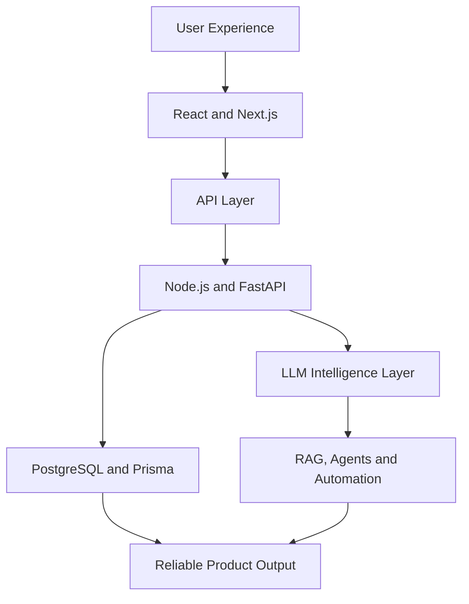

<!--
============================================================
  SAI SREEKAR DEVOJU
  GitHub Profile README
============================================================
-->


<p align="center">
  <a href="https://git.io/typing-svg">
    
  </a>
</p>

<p align="center">
  <a href="mailto:sreekardevoju6582@gmail.com">
    
  </a>
  <a href="https://linkedin.com/in/saisreekardevoju">
    
  </a>
  <a href="https://instagram.com/sreekar_devoju">
    
  </a>
  <a href="https://github.com/SaiSreekarDevoju?tab=repositories">
    
  </a>
</p>

<p align="center">
  
</p>

---

## `01 // SYSTEM IDENTITY`

```console
sai@sreekar:~$ ./initialize-profile

[BOOT] Loading developer identity...
[ OK ] Name          : Sai Sreekar Devoju
[ OK ] Role          : Full-Stack Developer & AI Engineer
[ OK ] Education     : B.E. Computer Science & Engineering — 2026
[ OK ] Location      : Hyderabad, India
[ OK ] Focus         : Full-Stack Systems · Backend Engineering · Applied AI
[ OK ] Availability  : Open to engineering opportunities

[SYSTEM] Profile initialization completed successfully.
```

I’m a **2026 Computer Science and Engineering graduate** based in Hyderabad, India.

I build responsive web applications, secure backend systems and practical AI-powered products. My work combines **full-stack engineering, database architecture, machine learning, Large Language Models, RAG and agentic workflows** to solve real user problems.

```typescript
const saiSreekar = {
  role: "Full-Stack Developer & AI Engineer",

  builds: [
    "Full-stack web applications",
    "Scalable backend systems",
    "Generative AI products",
    "Machine-learning applications",
  ],

  explores: [
    "Large Language Models",
    "Retrieval-Augmented Generation",
    "AI agents",
    "Intelligent automation",
    "Reliable AI evaluation",
  ],

  values: [
    "Clarity",
    "Reliability",
    "Security",
    "Accessibility",
    "Measurable user value",
  ],

  openTo: [
    "Software Engineering",
    "Full-Stack Development",
    "Backend Development",
    "AI/ML Engineering",
  ],
} as const;
```

---

## `02 // LIVE DEVELOPMENT LOG`

```text
╭─ SAI DEVELOPMENT NETWORK ─────────────────────────────────────╮
│                                                               │
│  [ACTIVE]  Building full-stack and Generative AI products     │
│  [ACTIVE]  Engineering authenticated REST APIs                │
│  [ACTIVE]  Connecting LLMs with real data through RAG         │
│  [ACTIVE]  Exploring intelligent agent workflows              │
│  [ACTIVE]  Improving accessibility and performance            │
│                                                               │
│  SIGNAL    ████████████████████████████████████  ONLINE       │
│                                                               │
╰───────────────────────────────────────────────────────────────╯
```

- 🔭 Building production-oriented full-stack and Generative AI applications
- 🧠 Exploring LLMs, RAG, AI agents, evaluation and automation
- ⚙️ Working with REST APIs, JWT authentication, Prisma and PostgreSQL
- 📄 Conducted research on AI-enhanced depression detection
- 🤝 Interested in web, backend and applied-AI collaborations
- 💼 Open to full-stack, software engineering, backend and AI/ML roles

---

## `03 // ENGINEERING CAPABILITIES`

| Domain | Capabilities |
|:---|:---|
| **Full-Stack Engineering** | React and Next.js applications, reusable components, responsive interfaces, API integration, authentication and accessible UX |
| **Backend Engineering** | REST APIs, Node.js, Express, FastAPI, JWT authentication, RBAC, validation and database architecture |
| **Applied AI** | LLM integration, RAG pipelines, LangChain workflows, prompt engineering, AI agents and intelligent automation |
| **Machine Learning** | Data preprocessing, feature engineering, classification, regression, model comparison and evaluation |
| **Data Engineering** | PostgreSQL, Prisma ORM, relational modelling, migrations, queries and structured data pipelines |
| **Product Engineering** | User-focused design, error handling, loading states, privacy controls, performance and maintainability |

---

## `04 // FEATURED SYSTEMS`

<details open>

<summary><b>◈ Lumen — On-Screen Intelligence</b></summary>

<br/>

A Manifest V3 Chrome extension that transforms content already visible on a user’s screen into structured and actionable summaries.

### Core systems

- Whole-page summarization
- Strict selected-text summarization
- Visual-region capture
- Context-aware follow-up conversations
- Multilingual output
- Privacy redaction
- Local searchable history
- Tab-isolated state management

### Architecture

`React` `TypeScript` `Chrome MV3` `LLMs` `Vision AI`

### Repository

[](https://github.com/SaiSreekarDevoju/TechBharat_Buildathon_SaiSreekarDevoju)

</details>

<details open>

<summary><b>◈ Mentoria.ai — AI Career Guidance Platform</b></summary>

<br/>

A full-stack career development platform designed to help users analyse their professional profiles and make informed career decisions.

### Core systems

- Resume ATS analysis
- Job-description gap detection
- AI-generated skill roadmaps
- Job matching and saved opportunities
- AI-powered mock interviews
- Career progress dashboard
- JWT access and refresh authentication
- Personalised user experiences

### Architecture

`Next.js` `FastAPI` `PostgreSQL` `LangChain` `LLMs`

</details>

<details>

<summary><b>◈ TeamFlow — Collaborative Task Manager</b></summary>

<br/>

A team productivity platform built around structured collaboration and transparent task execution.

### Core systems

- Kanban drag-and-drop workflows
- Subtasks and task priorities
- Role-based access control
- Notifications
- Time tracking
- Team and project search
- Project activity visibility
- PostgreSQL data persistence

### Architecture

`React` `Vite` `Node.js` `Express` `Prisma` `PostgreSQL`

</details>

<details>

<summary><b>◈ AI-Enhanced Depression Detection</b></summary>

<br/>

Research exploring depression detection through linguistic and behavioural signals found in social-media text.

### Research focus

- Natural Language Processing
- Text preprocessing
- Linguistic signal extraction
- Classification modelling
- Model evaluation
- Responsible AI considerations
- Mental-health data sensitivity

### Research status

Accepted at **ICSDCOIS 2025**.

### Technologies

`Python` `NLP` `Machine Learning` `Data Analysis`

</details>

<details>

<summary><b>◈ Customer Lifetime Value Prediction</b></summary>

<br/>

A machine-learning system for estimating long-term customer value using behavioural and transactional information.

### Core components

- RFM-based feature engineering
- Customer tenure analysis
- Churn-related attributes
- Linear, tree and ensemble models
- Model comparison and evaluation

### Technologies

`Python` `Pandas` `NumPy` `scikit-learn`

</details>

<details>

<summary><b>◈ Blockchain-Powered Hackathon Platform</b></summary>

<br/>

A decentralised hackathon-management system built around transparent submissions, evaluation and community governance.

### Core systems

- Smart-contract workflows
- Decentralised file storage
- IPFS and Filecoin integration
- DAO-style voting
- Transparent submission records

### Technologies

`Blockchain` `Smart Contracts` `IPFS` `Filecoin`

</details>

<p align="center">
  <a href="https://github.com/SaiSreekarDevoju?tab=repositories">
    
  </a>
</p>

---

## `05 // TECHNOLOGY MATRIX`

### Languages

<p align="center">
  
</p>

### Frontend and interface engineering

<p align="center">
  
</p>

### Backend and API engineering

<p align="center">
  
</p>

<p align="center">
  
  
  
</p>

### Databases and data architecture

<p align="center">
  
</p>

### Artificial intelligence and machine learning

<p align="center">
  
</p>

<p align="center">
  
  
  
  
</p>

<p align="center">
  
  
  
  
</p>

### Cloud, deployment and developer tools

<p align="center">
  
</p>

<p align="center">
  
  
  
</p>

---

## `06 // SYSTEM ARCHITECTURE`



---

## `07 // RESEARCH AND CREDENTIALS`

### Research

**AI-Enhanced Depression Detection in Social Media**

- Conference: ICSDCOIS 2025
- Focus: Natural Language Processing and machine learning
- Domain: Responsible mental-health signal analysis
- Status: Accepted research work

### Certifications

- Programming in Python – Meta
- Introduction to Databases – Meta
- SQL: A Practical Introduction for Querying Databases – IBM
- Databases and SQL for Data Science with Python – IBM
- Using Databases with Python – University of Michigan
- Continuous independent learning in AI and full-stack engineering

---

## `08 // ENGINEERING PROTOCOLS`

| Protocol | Engineering approach |
|:---|:---|
| **Product thinking** | Understand the user problem before selecting the technology. |
| **Reliability** | Treat loading states, edge cases and errors as product features. |
| **Security** | Build authentication, authorisation and privacy into the architecture. |
| **Applied AI** | Ground AI outputs in context and test failure modes carefully. |
| **Accessibility** | Design interfaces that remain understandable and usable. |
| **Maintainability** | Prefer clear boundaries, reusable components and documented decisions. |
| **Continuous growth** | Learn through building, testing, feedback and iteration. |

---

## `09 // GITHUB TELEMETRY`

<p align="center">
  
</p>

<p align="center">
  
  
</p>

<p align="center">
  
</p>

<p align="center">
  
</p>

> **Telemetry note:** Language cards measure public repository contents. They do not measure engineering proficiency.

---

## `10 // CONNECTION UPLINK`

<h3 align="center">Let’s engineer something meaningful.</h3>

<p align="center">
  I’m open to opportunities in Full-Stack Development, Software Engineering,
  Backend Engineering, AI/ML Engineering and Generative AI.
</p>

<p align="center">
  <a href="mailto:sreekardevoju6582@gmail.com">
    
  </a>
  <a href="https://linkedin.com/in/saisreekardevoju">
    
  </a>
</p>


