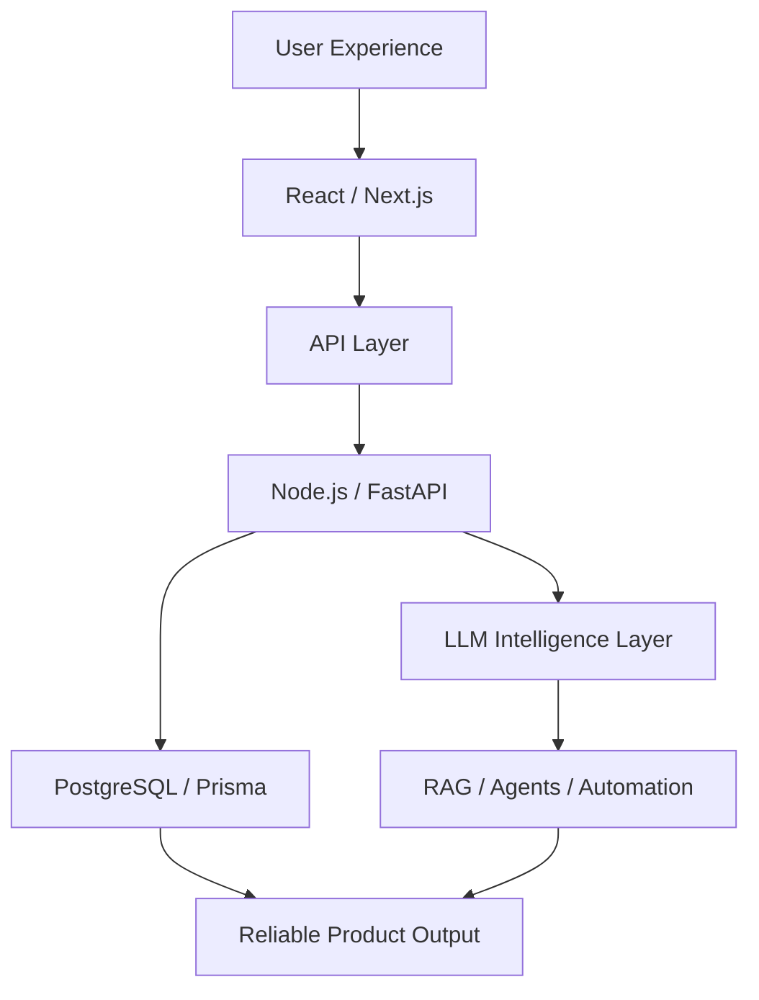

<!--
=========================================================
  SAI SREEKAR DEVOJU — GITHUB PROFILE
  Full-Stack Developer & AI Engineer
=========================================================
-->

<div align="center">


<a href="https://git.io/typing-svg">
  
</a>

<br/>

<a href="mailto:sreekardevoju6582@gmail.com">
  
</a>
<a href="https://linkedin.com/in/saisreekardevoju">
  
</a>
<a href="https://instagram.com/sreekar_devoju">
  
</a>
<a href="https://github.com/SaiSreekarDevoju?tab=repositories">
  
</a>

<br/><br/>


</div>

---

## `01 // IDENTITY`

```console
sai@sreekar:~$ ./initialize-profile

[BOOT] Loading developer identity...
[ OK ] Name          : Sai Sreekar Devoju
[ OK ] Role          : Full-Stack Developer & AI Engineer
[ OK ] Education     : B.E. Computer Science & Engineering — 2026
[ OK ] Location      : Hyderabad, India
[ OK ] Focus         : Full-Stack Systems · Backend Engineering · Applied AI
[ OK ] Availability  : Open to engineering opportunities

[SYSTEM] Profile initialization completed successfully.
```

I’m a **Computer Science and Engineering graduate** who builds responsive web applications, scalable backend systems, and practical AI-powered products.

My work combines **product engineering, secure API development, database architecture, machine learning, Generative AI, RAG, and agentic workflows** to transform complex problems into reliable user-focused software.

```typescript
const saiSreekar = {
  identity: "Full-Stack Developer & AI Engineer",

  builds: [
    "Full-stack web applications",
    "Scalable backend systems",
    "Generative AI products",
    "Machine-learning applications",
  ],

  currentlyExploring: [
    "Large Language Models",
    "Retrieval-Augmented Generation",
    "AI agents",
    "Intelligent automation",
    "Reliable AI evaluation",
  ],

  engineeringValues: [
    "Clarity",
    "Reliability",
    "Security",
    "Accessibility",
    "Measurable user value",
  ],

  openTo: [
    "Software Engineering",
    "Full-Stack Development",
    "Backend Development",
    "AI/ML Engineering",
  ],
} as const;
```

---

## `02 // LIVE DEVELOPMENT LOG`

```text
╭─ SAI DEVELOPMENT NETWORK ──────────────────────────────────────╮
│                                                               │
│  [ACTIVE]  Building full-stack and Generative AI products     │
│  [ACTIVE]  Engineering authenticated REST API architectures   │
│  [ACTIVE]  Connecting LLMs with real data through RAG         │
│  [ACTIVE]  Exploring intelligent agent workflows              │
│  [ACTIVE]  Improving product accessibility and performance    │
│                                                               │
│  SIGNAL    ████████████████████████████████████  ONLINE       │
│                                                               │
╰───────────────────────────────────────────────────────────────╯
```

- 🔭 Building production-oriented **full-stack and Generative AI applications**
- 🧠 Exploring **LLMs, RAG, AI agents, evaluation and automation**
- ⚙️ Working with **REST APIs, JWT, Prisma, LangChain and PostgreSQL**
- 📄 Conducted research on **AI-enhanced depression detection**
- 🤝 Interested in meaningful **web, backend and applied-AI collaborations**
- 💼 Open to **Full-Stack, Software Engineering, Backend and AI/ML roles**

---

## `03 // ENGINEERING CAPABILITIES`

<table>
<tr>
<td width="50%" valign="top">

### ◈ Full-Stack Engineering

- Responsive React and Next.js applications
- Reusable component architecture
- State management and API integration
- Authentication and protected interfaces
- Accessible and mobile-first experiences
- Performance-oriented frontend development

</td>
<td width="50%" valign="top">

### ◈ Backend Engineering

- RESTful API design
- Node.js, Express and FastAPI
- JWT access and refresh authentication
- Role-based access control
- PostgreSQL database architecture
- Prisma ORM and data validation

</td>
</tr>

<tr>
<td width="50%" valign="top">

### ◈ Applied Artificial Intelligence

- Large Language Model integration
- Retrieval-Augmented Generation
- LangChain workflows
- Prompt and context engineering
- AI agents and automation
- AI-powered product features

</td>
<td width="50%" valign="top">

### ◈ Machine Learning

- Data preprocessing and analysis
- Feature engineering
- Classification and regression
- Model comparison and evaluation
- Pandas, NumPy and scikit-learn
- Research-oriented NLP workflows

</td>
</tr>
</table>

---

## `04 // FEATURED SYSTEMS`

<table>
<tr>
<td width="50%" valign="top">

### ◈ Lumen

**On-Screen Intelligence Chrome Extension**

A Manifest V3 Chrome extension that transforms content already visible on a user’s screen into structured, actionable summaries.

#### Core systems

- Whole-page summarization
- Strict selected-text summarization
- Visual-region capture
- Context-aware follow-up conversations
- Multilingual output
- Privacy redaction
- Local searchable history
- Tab-isolated state management

#### Architecture

`React` `TypeScript` `Chrome MV3` `LLMs` `Vision AI`

<br/>

<a href="https://github.com/SaiSreekarDevoju/TechBharat_Buildathon_SaiSreekarDevoju">
  
</a>

</td>
<td width="50%" valign="top">

### ◈ Mentoria.ai

**AI Career Guidance Platform**

A full-stack career development platform designed to help users analyse their professional profile and make better career decisions.

#### Core systems

- Resume ATS analysis
- Job-description gap detection
- AI-generated skill roadmaps
- Job matching and saved opportunities
- AI-powered mock interviews
- Career progress dashboard
- Secure JWT authentication
- Personalised user experiences

#### Architecture

`Next.js` `FastAPI` `PostgreSQL` `LangChain` `LLMs`

</td>
</tr>

<tr>
<td width="50%" valign="top">

### ◈ TeamFlow

**Collaborative Team Task Manager**

A project and team productivity platform built around structured collaboration and transparent task execution.

#### Core systems

- Kanban drag-and-drop workflows
- Subtasks and task priorities
- Role-based access control
- Notifications
- Time tracking
- Team and project search
- Project activity visibility
- PostgreSQL persistence

#### Architecture

`React` `Node.js` `Express` `Prisma` `PostgreSQL`

</td>
<td width="50%" valign="top">

### ◈ AI Depression Detection

**Machine-Learning Research Project**

Research exploring AI-enhanced depression detection using linguistic and behavioural signals found in social-media text.

#### Research focus

- Natural Language Processing
- Text preprocessing
- Linguistic signal extraction
- Classification modelling
- Model evaluation
- Responsible AI considerations
- Mental-health data sensitivity

#### Research status

Accepted at **ICSDCOIS 2025**

#### Technologies

`Python` `NLP` `Machine Learning` `Data Analysis`

</td>
</tr>

<tr>
<td width="50%" valign="top">

### ◈ Customer Lifetime Value Prediction

A machine-learning system for estimating long-term customer value using behavioural and transactional information.

- RFM-based feature engineering
- Customer tenure analysis
- Churn-related attributes
- Linear, tree and ensemble models
- Model comparison and evaluation

`Python` `Pandas` `NumPy` `scikit-learn`

</td>
<td width="50%" valign="top">

### ◈ Blockchain Hackathon Platform

A decentralised hackathon-management concept using blockchain-based submissions, transparent evaluation and community governance.

- Smart-contract workflows
- Decentralised file storage
- IPFS and Filecoin integration
- DAO-style voting
- Transparent submission records

`Blockchain` `Smart Contracts` `IPFS` `Filecoin`

</td>
</tr>
</table>

<div align="center">

<a href="https://github.com/SaiSreekarDevoju?tab=repositories">
  
</a>

</div>

---

## `05 // TECHNOLOGY MATRIX`

### Languages

<div align="center">


</div>

### Frontend and Interface Engineering

<div align="center">


</div>

### Backend and API Engineering

<div align="center">


<br/><br/>


</div>

### Databases and Data Architecture

<div align="center">


</div>

### AI, Machine Learning and Data Science

<div align="center">


<br/><br/>


<br/>


</div>

### Cloud, Deployment and Engineering Tools

<div align="center">


<br/><br/>


</div>

---

## `06 // SYSTEM ARCHITECTURE`



---

## `07 // RESEARCH AND LEARNING`

<table>
<tr>
<td width="50%" valign="top">

### Research

**AI-Enhanced Depression Detection in Social Media**

- Conference: ICSDCOIS 2025
- Focus: NLP and machine learning
- Domain: Responsible mental-health signal analysis
- Status: Accepted research work

</td>
<td width="50%" valign="top">

### Certifications

- Introduction to Machine Learning — Infosys
- Python and Django — Coursera
- Cloud Computing — NPTEL
- Continuous independent learning in AI and full-stack engineering

</td>
</tr>
</table>

---

## `08 // ENGINEERING PROTOCOLS`

| Protocol | Engineering approach |
|:---|:---|
| **Product Thinking** | Understand the user problem before selecting the technology. |
| **Reliability** | Treat loading states, edge cases and errors as product features. |
| **Security** | Build authentication, authorisation and privacy into the architecture. |
| **Applied AI** | Ground AI outputs in context and test failure modes carefully. |
| **Accessibility** | Design interfaces that remain understandable and usable. |
| **Maintainability** | Prefer clear boundaries, reusable components and documented decisions. |
| **Continuous Growth** | Learn through building, testing, feedback and iteration. |

---

## `09 // GITHUB TELEMETRY`

<div align="center">


<br/>


<br/>


<br/>


</div>

> **Telemetry note:** Language cards measure the contents of public repositories. They do not measure engineering proficiency.

---

## `10 // CONNECTION UPLINK`

<div align="center">

### Let’s engineer something meaningful.

I’m open to opportunities in **Full-Stack Development, Software Engineering, Backend Engineering, AI/ML Engineering and Generative AI**.

<br/>

<a href="mailto:sreekardevoju6582@gmail.com">
  
</a>

<a href="https://linkedin.com/in/saisreekardevoju">
  
</a>

<br/><br/>

```text
╭──────────────────────────────────────────────────────╮
│                                                      │
│   BUILD WITH INTENT  •  SHIP WITH CARE  •  EVOLVE   │
│                                                      │
╰──────────────────────────────────────────────────────╯
```


</div>
